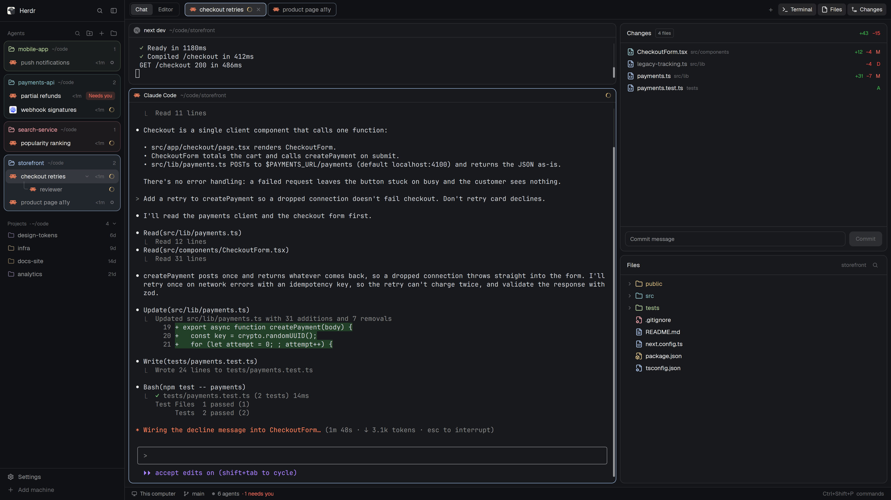
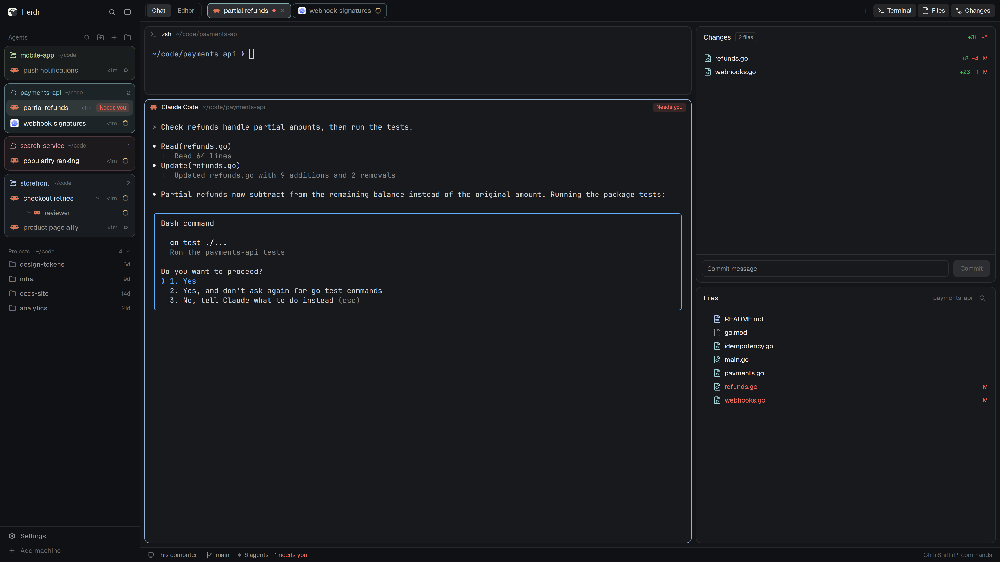
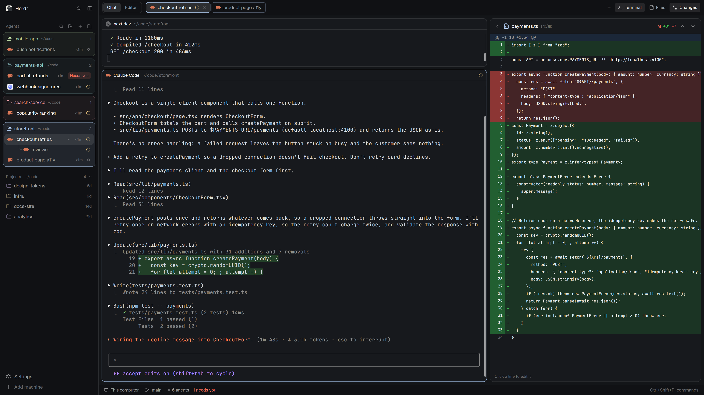
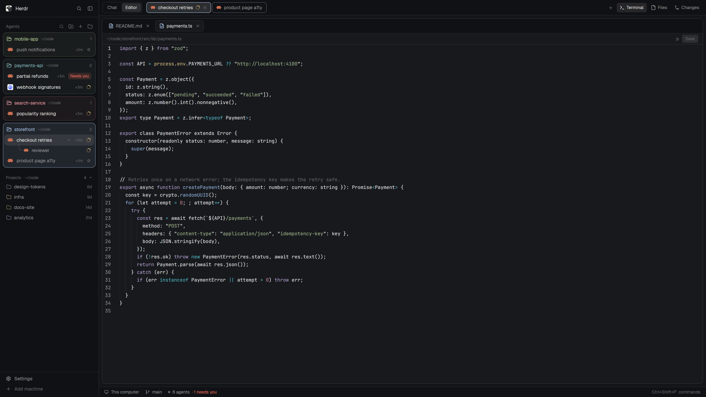
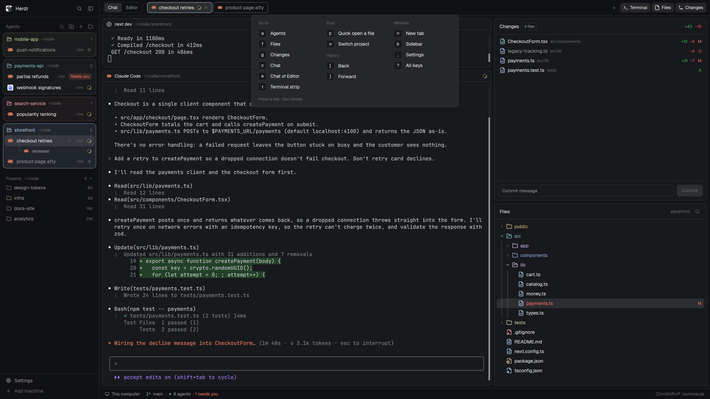

# herdr-dendro

A [Herdr](https://herdr.dev) layout for running several coding agents at once.



## Highlights

**Agents grouped by project.** Each repo gets a colour-coded box, and an agent waiting on you is flagged **Needs you**.



**Review and commit.** Open a changed file's diff, edit a line in place, and commit from the Changes panel.



**Built-in editor.** Files open in tabs beside the chat and reload when an agent changes them.



**Keyboard first.** `Ctrl+Space` and one key reaches any panel, file or project; the panels take `j` `k`, `Enter` and `Esc`.



**Also:**
- **Projects:** every git repo in a folder such as `~/code`, most recently committed first; right-click to start an agent there.
- **Quick open** (`Alt+P`) for any file in the repo, and a **switcher** (`Alt+O`) for projects and their recent sessions.
- A shell strip above each chat, rendered Markdown with pictures, and Files with type icons and git marks.
- Status bar with branch, agent count and your Claude plan limits.

## Keyboard

Press `Ctrl+Space`, then:

| Key | Does | | Key | Does |
|---|---|---|---|---|
| `a` | Agents (sidebar) | | `p` | Quick open a file |
| `f` | Files | | `o` | Switch project |
| `g` | Changes | | `[` `]` | Back / forward |
| `c` | Chat | | `n` | New tab |
| `e` | Chat ⇄ Editor | | `b` | Sidebar |
| `t` | Terminal strip | | `,` `?` | Settings, all keys |

While dendro shows, `Ctrl+Space` doesn't reach terminal programs. Emacs uses it to set the mark; to use another key, change `ctrl-space` in the `layout:dendro` section of `~/.config/herdr-app/keys.json`.

## Install

Needs Herdr 0.1.16.

```sh
./install.sh
```

Then press `Ctrl+Shift+L` and pick **dendro**. Run it again after pulling.

It copies the layout and `dendro-*` mods into `~/.config/herdr-app` (or `$HERDR_APP_HOME`) and adds dendro's shortcuts to `keys.json` (your old one is kept as `keys.json.before-dendro`). From then on Herdr treats `keys.json` as yours, so new default shortcuts in later Herdr versions must be added by hand.

**Uninstall:** pick another layout, then delete `layouts/dendro.json` and `mods/dendro-*` from `~/.config/herdr-app`, and the `layout:dendro` section from its `keys.json`.

### Claude limits (optional)

Needs `python3`. Add this to `~/.claude/settings.json` (it replaces any existing `statusLine`):

```json
"statusLine": { "type": "command", "command": "~/.config/herdr-app/mods/dendro-status-bar/claude-statusline.py" }
```

Limits show when you're signed in with a Claude subscription, and update as sessions get responses.

## License

MIT, see `LICENSE`.

Icons from **[Lucide](https://lucide.dev)** (ISC, some MIT via Feather) are noted in `LICENSE-lucide.txt` in each mod that ships them: the file-type icons in `mods/dendro-files-panel/icons/`, plus `folder.svg`, `folder-open.svg`, `chevron-*.svg`, `x.svg`, `terminal.svg`, `sort-folder.svg`, `file-plus.svg` and `folder-plus.svg`. No product or language logos are included.
