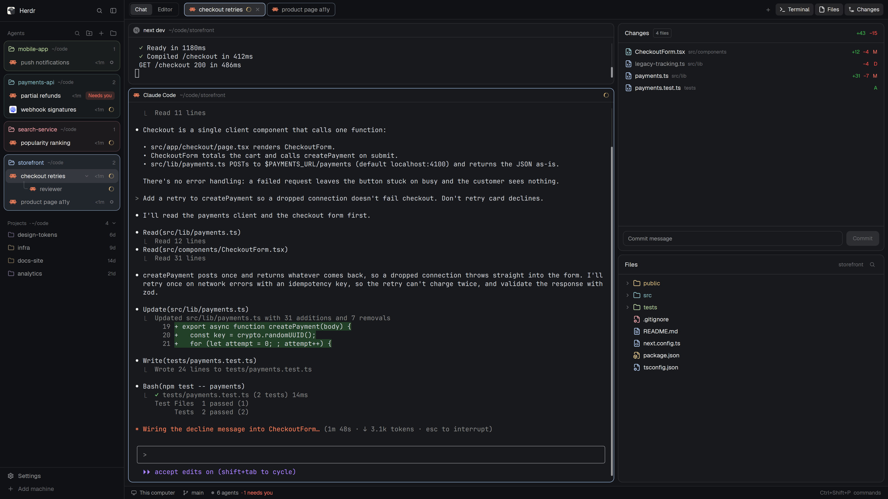

# dendro

A layout for running several coding agents at once. On the left, agents are grouped into colour-coded boxes by project, and one waiting on you is flagged **Needs you**. The agent's chat is in the middle, with a built-in editor one click away. Changes and Files sit stacked on the right. Everything can be reached from the keyboard through a `Ctrl+Space` leader.

## What you see

Left to right. Sizes are at zoom 1. Colours are theme keys, so the layout follows any theme.

- **Sidebar**, 268px wide on `chrome`, not resizable. From the top:
  - The shipped `workspace-chrome` brand row (46px, drags the window).
  - The Agents panel, which fills the middle.
  - `workspace-chrome` with `{ "footer": true }` (69px: Settings, Add machine).
  - Below 160px wide the sidebar becomes a rail: 44px, or 76px on macOS.
- **Agents panel** (`dendro-agents-panel`):
  - A header row reading "Agents", with search, new folder, new agent, and a sort button. Sorts: grouped by folder, priority, or by space.
  - A rounded box per project. A project is the agent's git repo, or else its folder. Each box has a light border and tint in its own colour, taken from the theme's bright ANSI colours, and no two boxes on show share one. The header shows the folder name in that colour, its parent path dimmed, and the agent count.
  - An agent row shows the program's icon, the session title, its age, and its status (see *How it behaves*). Sub-agents sit under their parent with a tree elbow.
  - The box for the space you're in has a stronger border.
  - Spaces with no agents are listed under **No agents**.
  - **Projects** comes last: every git repo directly inside a folder you add (such as `~/code`), most recently committed first, each with its age.
- **Tab bar** (`dendro-tab-bar`, 42px, drags the window), from the left:
  - A **Chat | Editor** segment.
  - The space's tabs. Each shows the agent icon, the title (cut to 12 characters; the full title is the tooltip), a spinner while working, and × on hover. An agent's tab is bordered in its project box's colour.
  - `+` for a new tab.
  - **Terminal**, **Files** and **Changes** toggle buttons.
  - Window buttons (`win-*.svg`), because the titlebar is off.
- **Centre**, a stack in a row with 8px padding and an 8px gap:
  - `main`: the active tab's panes. Radius 10, 1px `border` (`accent` when focused), and the shipped `pane` mod as a 30px header.
  - `editor` (`dendro-editor`): editor tabs (40px strip), a 30px path bar (path, Preview/Edit for Markdown, language, Save), then Herdr's `Editor`. Markdown shows rendered, pictures included.
- **Right column** `panel`, 440px wide (280–1000), split into two equal blocks with an 8px gap:
  - **Changes** (`dendro-diff-panel`), on top: "Changes" with a file-count pill and total `+N −N` in green and red. One row per changed file: type icon, name, dimmed folder, `+N −N`, and a letter: M, A, D, or U for a conflict. At the bottom, a commit message box and **Commit**. Opening a file swaps the panel to its diff: GitHub-style green and red lines with numbers, and a header with the file and up/down/back chevrons.
  - **Files** (`dendro-files-panel`): "Files" with the repo name and a search button (opens quick open), then a tree. Lucide file glyphs are tinted by type. Folder names are coloured by name from the bright ANSI colours, so `src` has the same colour in every project. Thin indent guides take the colour of each open folder, and git marks show on the right.
- **Status bar** (`dendro-status-bar`, 28px): the machine, the branch, the agent count with "N needs you" in `blocked`, and, when set up, your Claude plan limits for 5 hours and the week. On the right: "Ctrl+Shift+P commands".
- **Popups** (`t.popover`, 31px rows):
  - Quick open (640 wide, 60% high, near the top).
  - Switcher (640 wide, 70% high).
  - Leader (560×300): three columns of key and label.
  - Right-click menus.

## How it behaves

- **Agent status** in the Agents panel:
  - working: a spinning ring in `working`.
  - blocked: a **Needs you** pill (`blocked` text on a 15% `blocked` fill), or `!` where a header already says Needs you.
  - done: a dot in the box's colour.
  - idle: a hollow ring, with the name in `muted`.
  - Looking at a done agent makes it idle. A sub-agent is never done, because its parent reports that.
  - A folded box shows its most urgent status.
- **Clicks:**
  - An agent row focuses its pane. A box header folds the box.
  - Right-clicking an agent offers a new session of the same agent in the same folder, plus the space's menu: rename, worktrees, close.
  - Clicking a project opens it in a new space, or goes to its space. Right-clicking a project starts any installed agent there.
  - A file in Files opens in the editor. A changed file opens its diff, and clicking a diff line edits it in place (Enter saves, Shift+Enter saves and adds a line).
- **Tabs:**
  - An unnamed tab takes its agent's session title. A name you gave it is kept.
  - The Terminal button pins a shell above the chat at 10% of the tab's height, never under 4 rows. Turning it off parks the shell rather than closing it.
- **Editor:**
  - Tabs are kept per space.
  - It reloads when the file changes on disk. If you've edited the file too, it asks "Reload (discard mine)" or "Keep mine & save".
  - `Ctrl+S` saves and `Ctrl+W` closes.
- **Keys** (`keys.json`, section `layout:dendro`):
  - `Ctrl+Space` opens the leader. Then `a` Agents, `f` Files, `g` Changes, `c` Chat, `e` Chat⇄Editor, `t` terminal strip, `p` quick open, `o` switcher, `[` `]` back/forward, `n` new tab, `b` sidebar, `,` settings, `?` help.
  - `Alt+P` or `⌘P` opens quick open. `Alt+O` or `⌘O` opens the switcher. `Alt+←` and `Alt+→` go back and forward through spaces, tabs and Chat/Editor.
- **In a panel** with the keyboard, the panel border turns `accent` and a 2px accent bar marks the cursor row. Keys:
  - `j` `k` or arrows to move, `g` `G` for first and last, Page Up and Page Down.
  - `l` or `→` unfolds, `h` or `←` folds or goes to the parent.
  - `Enter` opens. `m` or `Shift+F10` opens the row's menu as a centred dialog. `Esc` goes back to the chat.
- **Quick open** lists the repo's files from `git ls-files`, tracked and new but not ignored. With nothing typed it shows recent files.
- **The switcher** lists the project boxes, most recent first, each with its 3 latest sessions, then the Projects. With nothing typed it picks the project you were in before this one.

## Built from

- **Layout** (`layouts/dendro.json`):
  - A `row` with `titlebar: none`, background `canvas` and 1px `border` dividers.
  - `sidebar` (column): `brand`, `sidebar-lists` › `agents`, `sidebar-footer`.
  - `work` (column): `tabs`, then `work-body` (row), then `status`.
  - `work-body` holds `center` (a stack: `main` with `{ tab: "active" }` pane styling, and `editor`) and `panel` (column: `changes`, `files`).
- **Mods:**

  | Mod | Role |
  |---|---|
  | `dendro-agents-panel` | the sidebar list, project colours, its own right-click menus (a popup of itself) |
  | `dendro-tab-bar` | tabs, the Chat/Editor stack (`layout.select`), panel show/hide, the shell strip (`terminal.open`, `terminal.park`), back/forward, panel focus routing |
  | `dendro-editor` | the editor |
  | `dendro-diff-panel` | Changes |
  | `dendro-files-panel` | Files |
  | `dendro-files-menu` | Files' right-click popup |
  | `dendro-quick-open` | quick open |
  | `dendro-switcher` | the switcher |
  | `dendro-leader` | the leader |
  | `dendro-status-bar` | the status bar, plus `claude-statusline.py` |
- **Shipped mods used:**
  - In the layout: `workspace-chrome` and `pane`.
  - Icons from `workspace-chrome` (search, spinner, plus, check, chevron, folder-plus), `pane` (close), `changes` and `files`.
- **Talking between mods** goes through `shared`:
  - `dendro.focus`: give a panel the keyboard.
  - `dendro.open`: open a file in the editor.
  - `dendro.switcher`: the switcher's list, built by the Agents panel.
  - `dendro.agents.tabColors`: each tab's colour.
  - `dendro.editor.dirty`.
  - Commands go to each mod's `nextCommand()`.
- **Herdr functions:**
  - `agents`, `terminals`, `panes`, `spaces`, `focused`, `layout`, `theme`, `settings`, `keys`, `knownAgents`.
  - `run`, `openOverlay`, `closeOverlay`, `shared`, `setShared`, `setAgentOrder`, `nextCommand`.
  - `exec`, `watchFolder`, `readTextFile`, `writeTextFile`, `pickFolder`, `home`, `appHome`.
- **Programs run:**
  - `git`: status, diff, ls-files, commit. Reads use `--no-optional-locks -c core.fsmonitor=false -c diff.autoRefreshIndex=false`, so they write nothing under `.git`.
  - `sh` (PowerShell on Windows): folder listing and Markdown pictures.
  - `mkdir`: New Folder.
- **Art:**
  - Lucide icons (ISC; see `LICENSE-lucide.txt` in each mod) for file types, folders, chevrons, close, terminal, new file and new folder.
  - Original `changes.svg` and `win-*.svg`.

## Watch out

- **What the mods access.** They run `git` and `sh`/PowerShell, and read and write files in your projects: saving in the editor, New File and New Folder, committing. The status bar reads `~/.cache/herdr-dendro/claude-limits.json`. Nothing uses the network.
- **Shared helper files.** Mods can't import across folders, so `icons.js` and `listnav.js` live in `dendro-files-panel` and `fuzzy.js` in `dendro-quick-open`. The other mods carry copies. Keep them in step: `install.sh` re-syncs them.
- **Markdown pictures.** `TextView` draws no images, and `image()` reads only from Herdr's folder. The editor splits Markdown at lines that are only a picture and links each local one under `data/dendro-editor/img/` (a copy on Windows), named with its modified time. Herdr keeps an image by its name, so the 2s poll relinks a picture that changed. Web pictures show as a link. Pictures inside a sentence don't show, and a reference-style link split from its definition by a picture breaks.
- **Keyboard quirks:**
  - There's no blur event. Panels poll `is_focused()` every 250ms while focused, so the cursor clears when they lose the keyboard.
  - Herdr closes popups on Esc itself. A keyboard-opened menu gives the keyboard back in its `close()`, and the panel refocuses at 150 and 400ms, because Herdr refocuses the last pane.
  - Menus opened from the keyboard are `kind: "dialog"` (centred). Opened by mouse, they are `kind: "popup", at: "pointer"`.
- **The shell strip** keeps at least 4 rows. With fewer than 3, zsh draws its prompt in a one-line mode that shows `?` for glyphs.
- **`Ctrl+Space`** is taken from terminals while dendro shows, so Emacs loses set-mark there (as do shells or tmux setups that bind it). To use another key, change `ctrl-space` in `layout:dendro`.
- **Depends on shipped mods.** It uses the shipped `workspace-chrome`, `pane`, `changes` and `files` mods' icons and blocks. A later Herdr that renames them breaks those.
- **Needs Herdr 0.1.16.** The status bar's Claude limits need `claude-statusline.py` set as Claude Code's `statusLine`, which needs `python3`.
